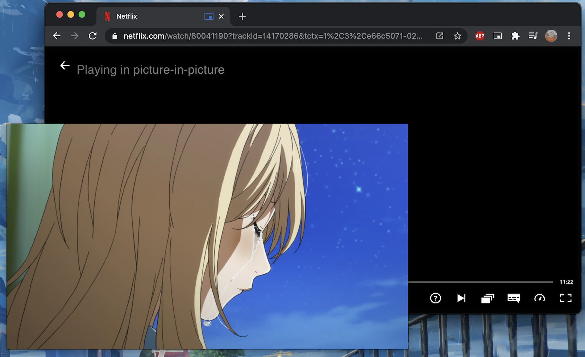

<h1 align="center">simple-pip</h1>

    
    
    

A cross-platform extension that adds a button to pop out videos using the Picture-in-Picture API.

## Installation

### Chromium Browsers (i.e. Google Chrome)

1. Download the [latest release](https://github.com/ayvacs/simple-pip/releases) and unzip it (or clone this repository).
2. Open `chrome://extensions` in your browser.
3. Enable **Developer mode** in the top right corner.
4. Click **Load unpacked** and select the `src` directory.

### Mozilla Firefox

1. Download the [latest release](https://github.com/ayvacs/simple-pip/releases) and unzip it (or clone this repository).
2. Open `about:debugging#/runtime/this-firefox` in your browser.
3. Click **Load Temporary Add-on...**.
4. Select the `manifest.json` file located in the `src` directory.

To view full project documentation, visit the <a href="https://ayvacs.github.io/simple-pip">project documentation</a>.

