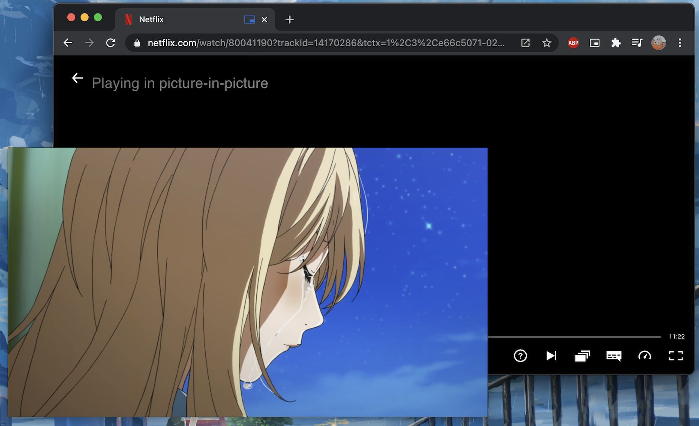

<h1 align="center">simple-pip</h1>

  
  
  
  
  

A cross-platform extension that adds a button to pop out videos using the Picture-in-Picture API.

# Instructions

## Installation

### Chromium Browsers (i.e. Google Chrome)

1. Download the [latest release](https://github.com/ayvacs/simple-pip/releases) and unzip it
2. Open Chrome's extension page (`chrome://extensions`)
- Make sure *Developer mode* is enabled on the top right
3. Select *Load unpacked*
4. Select the release folder's `src` directory

### Mozilla Firefox

1. Download the [latest release](https://github.com/ayvacs/simple-pip/releases) and unzip it
2. Open Firefox's debugging page (`about:debugging#/runtime/this-firefox`)
3. Select *Load Temporary Add-on...*
4. Select the `manifest.json` file inside the release folder's `src` directory

## Using the extension

To enter Picture-in-Picture mode, click the extension icon or press **Alt+P**. It will pop out the largest video on the page you're currently viewing.

To exit Picture-in-Picture mode, click the icon or press **Alt+P** again. If a video is in picture-in-picture mode, it will return to the page.

## Using light mode icons

If you use Light Mode, a set of supplementary icons are available under the **light-mode-icons** branch.

1. Download the [light mode icons](https://github.com/ayvacs/simple-pip/tree/light-mode-icons) branch and unzip it
2. Make sure you have the [latest release](https://github.com/ayvacs/simple-pip/releases) downloaded
3. Before installing the extension, replace the images in `src/assets` with the ones you downloaded
4. Now you can install the extension!
