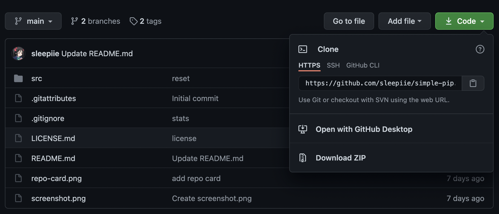

# Source code

The source code for the extension is available on [GitHub](https://github.com/ayvacs/simple-pip).

## Downloading the code

## via Releases

1. Download the [latest release](https://github.com/ayvacs/simple-pip/releases) and unzip it
2. In Chrome: navigate to `chrome://extensions`, enable *Developer mode*, click *Load unpacked*, and select the `src` directory
3. In Firefox: navigate to `about:debugging#/runtime/this-firefox`, click *Load Temporary Add-on...*, and select `src/manifest.json`

## via main branch

1. Download the GitHub repository's code 
2. Unzip the file
3. In Chrome: navigate to `chrome://extensions`, enable *Developer mode*, click *Load unpacked*, and select the `src` directory
4. In Firefox: navigate to `about:debugging#/runtime/this-firefox`, click *Load Temporary Add-on...*, and select `src/manifest.json`

<!--Footer -->

<h1 align="center">simple-pip</h1>

  
  
  
  
  

A cross-platform extension that adds a button to pop out videos using the Picture-in-Picture API.

